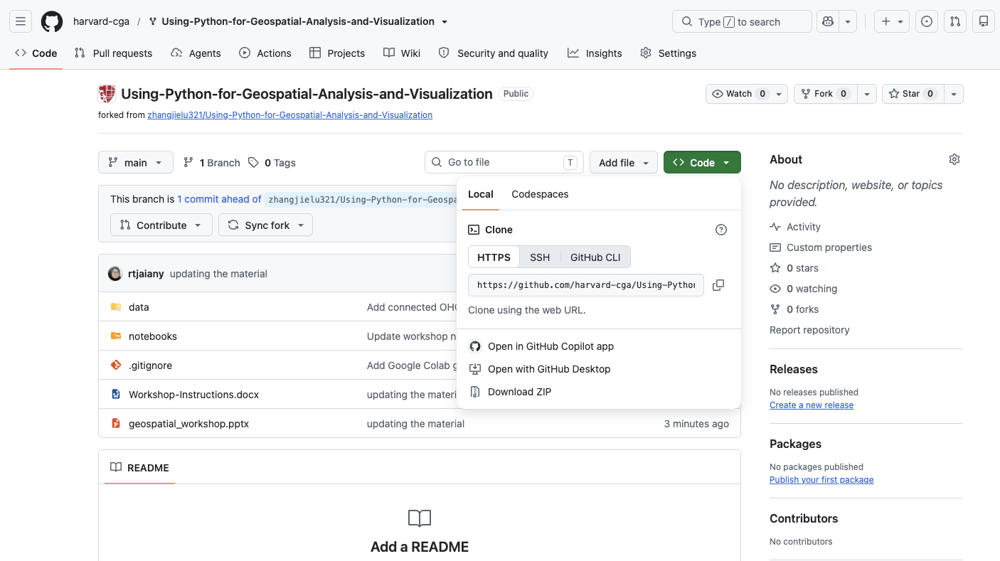
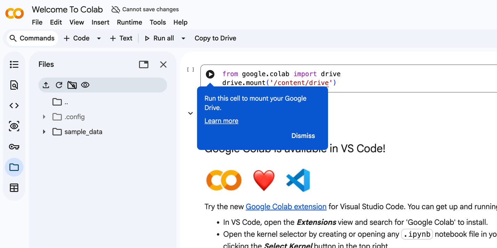
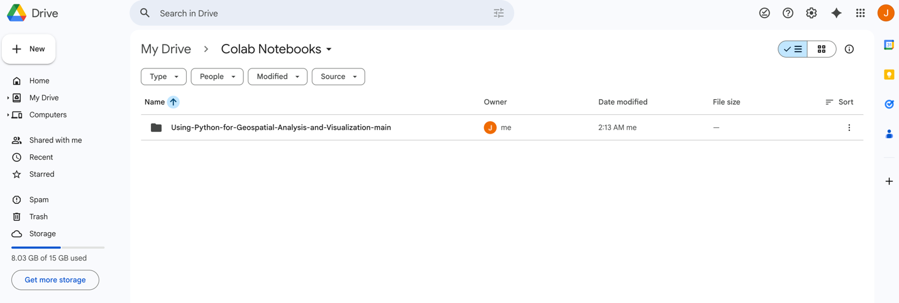
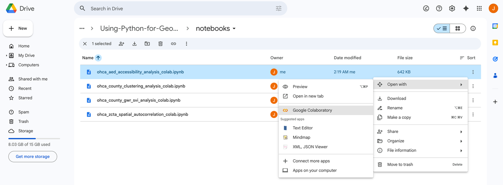
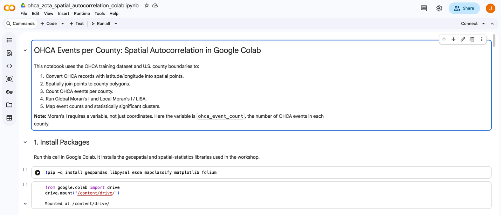

<p align="center"></p>

# Using Python for Geospatial Analysis and Visualization

Workshop materials from the Harvard Center for Geographic Analysis (CGA). Across four Google Colab notebooks, you'll use out-of-hospital cardiac arrest (OHCA) events in Georgia to practice spatial autocorrelation, spatial heterogeneity (GWR), spatial clustering, and spatial accessibility (2SFCA) analysis in Python.

**Web version of these instructions:** [`index.html`](index.html)

## Workshop details

| | |
|---|---|
| **Lead Instructor** | Devika Jain |
| **Teaching Assistant** | Jaiany Rocha |
| **Time** | 01:00 PM–04:00 PM, November 20, 2026 |
| **Location** | 1737 Cambridge St., Cambridge, MA, CGIS Knafel Building, Room SB-12, Sub-Basement |
| **Zoom** | [https://harvard.zoom.us/j/92058503195](https://harvard.zoom.us/j/92058503195?pwd=lK3lJ1r63GfAlTbcan7ZDVDajKvUJc.1) |

## Repository structure

```text
.
├── data/                 # Input data (OHCA events, county & ZCTA shapefiles, Georgia SVI)
│   └── outputs/          # Example outputs produced by the notebooks (CSV, GeoJSON, PNG)
├── docs/                 # Workshop-Instructions.docx
├── images/               # Screenshots used in these instructions
├── notebooks/            # Google Colab notebooks for the four analyses
├── slides/               # Workshop slide deck
├── index.html            # Web version of the workshop instructions
└── README.md
```

> **Note:** `data/ohca_connected_data.csv` is listed in `.gitignore` because it is protected source data. If it is not in your download, ask the instructors for a copy.

## Pre-workshop instructions

You'll need a laptop for this workshop. Please complete the following steps before it begins:

1. Download the GitHub repository for this workshop to your local computer. (1) Go to: <https://github.com/harvard-cga/Using-Python-for-Geospatial-Analysis-and-Visualization> (2) Click **Download ZIP** as shown below. If you do not have a GitHub account, download from [this Google Drive folder](https://drive.google.com/drive/folders/1TSVZkt-byvCoKZRsf82C5BepTWTlyStC?usp=sharing).

   

2. Log in to Google Colab using your Gmail account: <https://colab.research.google.com/>

3. Mount your Google Drive in Google Colab.

   

4. Open your Google Drive and upload the workshop folder (downloaded in step 1) to: `My Drive / Colab Notebooks`

   

5. Open the notebook file (`.ipynb`) using Google Colaboratory.

   

6. Randomly select one notebook and make sure you can run it successfully. Use `Shift + Enter` on Windows or `Shift + Return` on macOS to run each cell. If you are unable to complete this step successfully, no worries — we can work through it together during the workshop.

   

## In-workshop instructions

| # | Topic | Notebook |
|---|---|---|
| 1 | Spatial Autocorrelation | [`ohca_zcta_spatial_autocorrelation_colab.ipynb`](notebooks/ohca_zcta_spatial_autocorrelation_colab.ipynb) |
| 2 | Spatial Heterogeneity | [`ohca_county_gwr_svi_analysis_colab.ipynb`](notebooks/ohca_county_gwr_svi_analysis_colab.ipynb) |
| 3 | Spatial Clustering | [`ohca_county_clustering_analysis_colab.ipynb`](notebooks/ohca_county_clustering_analysis_colab.ipynb) |
| 4 | Spatial Accessibility | [`ohca_aed_accessibility_analysis_colab.ipynb`](notebooks/ohca_aed_accessibility_analysis_colab.ipynb) |

### 1. Spatial Autocorrelation

**Notebook:** [`ohca_zcta_spatial_autocorrelation_colab.ipynb`](notebooks/ohca_zcta_spatial_autocorrelation_colab.ipynb)

**Purpose:** This notebook tests whether OHCA event counts are spatially clustered across Georgia counties. The filename says zcta, but the workflow uses counties.

<details>
<summary><strong>A. Setup and Libraries</strong></summary>

1. Installs geospatial and spatial statistics packages.
2. Imports geopandas, pandas, matplotlib, libpysal, and esda.
3. Imports tools for spatial weights, Moran's I, and Local Moran's I.

</details>

<details>
<summary><strong>B. Load OHCA Points</strong></summary>

1. Reads OHCA records from the CSV.
2. Converts latitude and longitude columns to numeric.
3. Drops rows with missing coordinates.
4. Creates point geometries.
5. Stores OHCA events as a GeoDataFrame in WGS84.

</details>

<details>
<summary><strong>C. Initial Point Map</strong></summary>

1. Plots all OHCA points.
2. Uses the map to check whether the coordinates appear reasonable.

</details>

<details>
<summary><strong>D. Load Georgia Counties</strong></summary>

1. Reads the county shapefile.
2. Reprojects counties to WGS84.
3. Filters to Georgia counties.
4. Keeps county ID, county name, and geometry.
5. Maps county boundaries with OHCA points for alignment checking.

</details>

<details>
<summary><strong>E. Spatial Join</strong></summary>

1. Joins each OHCA point to the county polygon that contains it.
2. Counts how many OHCA points matched a county.
3. Counts how many points did not match.
4. Previews joined event records with county information.

</details>

<details>
<summary><strong>F. Count OHCA Events Per County</strong></summary>

1. Groups joined OHCA points by county.
2. Counts the number of events in each county.
3. Merges those counts back onto county polygons.
4. Creates `ohca_event_count`.
5. Displays counties with the largest counts.

</details>

<details>
<summary><strong>G. Map Event Counts</strong></summary>

1. Creates a county choropleth map.
2. Colors counties by OHCA event count.
3. Uses quantile classification for map classes.
4. Helps to visually inspect high-count and low-count counties.

</details>

<details>
<summary><strong>H. Create Spatial Weights</strong></summary>

1. Builds Queen contiguity weights so neighboring counties are connected.
2. Checks whether any counties have no neighbors.
3. Uses K-nearest neighbors as a backup if needed.
4. Row-standardizes the weights.

</details>

<details>
<summary><strong>I. Global Moran's I</strong></summary>

1. Uses county OHCA counts as the analysis variable.
2. Runs Global Moran's I.
3. Reports the Moran's I statistic.
4. Reports a p-value.
5. Tests whether high or low OHCA counts are spatially clustered overall.

</details>

<details>
<summary><strong>J. Local Moran's I / LISA</strong></summary>

1. Runs Local Moran's I for each county.
2. Stores local statistic values and p-values.
3. Calculates spatial lag values.
4. Classifies counties into cluster types such as high-high, low-low, high-low, low-high, or not significant.
5. Counts how many counties fall into each category.

</details>

<details>
<summary><strong>K. LISA Map and Exports</strong></summary>

1. Maps significant local cluster categories.
2. Saves the LISA cluster map.
3. Exports county spatial autocorrelation results as CSV.
4. Exports mapped results as GeoJSON.

</details>

### 2. Spatial Heterogeneity

**Notebook:** [`ohca_county_gwr_svi_analysis_colab.ipynb`](notebooks/ohca_county_gwr_svi_analysis_colab.ipynb)

**Purpose:** This notebook focuses on how to model the relationship between county OHCA counts and social vulnerability variables, allowing that relationship to vary spatially using GWR.

<details>
<summary><strong>A. Setup and Inputs</strong></summary>

1. Installs geopandas, mgwr, matplotlib, and mapclassify.
2. Imports geospatial, data, and modeling libraries.
3. Defines paths to OHCA data, county boundaries, and the Georgia SVI table.

</details>

<details>
<summary><strong>B. Create County OHCA Counts</strong></summary>

1. Loads OHCA event records.
2. Cleans latitude and longitude.
3. Converts events into point geometries.
4. Loads Georgia county polygons.
5. Spatially joins OHCA points to counties.
6. Counts OHCA cases per county.
7. Fills counties with no matched events as zero cases.

</details>

<details>
<summary><strong>C. Load and Prepare SVI Variables</strong></summary>

1. Reads the SVI county CSV.
2. Creates a five-digit county GEOID.
3. Selects SVI variables such as age 65+, disability, uninsured, poverty, education, unemployment, no vehicle, and minority status.
4. Converts SVI columns to numeric values.
5. Checks whether required SVI columns exist.

</details>

<details>
<summary><strong>D. Merge OHCA and SVI Data</strong></summary>

1. Merges county OHCA counts with county SVI variables.
2. Drops counties missing required predictor data.
3. Creates the final county modeling GeoDataFrame.

</details>

<details>
<summary><strong>E. Prepare GWR Inputs</strong></summary>

1. Reprojects counties to `EPSG:3857`.
2. Uses county centroids as model coordinates.
3. Sets the outcome variable to log1p(ohca_cases).
4. Standardizes SVI predictors using z-scores.
5. Creates the predictor matrix for GWR.

</details>

<details>
<summary><strong>F. Fit GWR Model</strong></summary>

1. Uses bandwidth selection to choose an adaptive neighborhood size.
2. Fits a Geographically Weighted Regression model.
3. Prints the GWR summary.
4. Allows relationships between SVI variables and OHCA counts to vary by county.

</details>

<details>
<summary><strong>G. Save Local Model Results</strong></summary>

1. Adds local intercepts to each county.
2. Adds local coefficients for each SVI predictor.
3. Adds local R² values.
4. Adds filtered local t-values.
5. Previews selected coefficient columns.

</details>

<details>
<summary><strong>H. Map GWR Results</strong></summary>

1. Maps one local SVI coefficient, often `EP_POV150`.
2. Shows where that predictor has stronger or weaker local association with OHCA counts.
3. Maps local R² to show where the model fits better or worse.
4. Uses quantile choropleth maps for interpretation.

</details>

<details>
<summary><strong>I. Export Outputs</strong></summary>

1. Creates an outputs folder.
2. Saves county GWR results as CSV.
3. Saves county GWR results as GeoJSON.
4. Saves the selected coefficient map as PNG.
5. Saves the local R² map as PNG.

</details>

### 3. Spatial Clustering

**Notebook:** [`ohca_county_clustering_analysis_colab.ipynb`](notebooks/ohca_county_clustering_analysis_colab.ipynb)

**Purpose:** This notebook focuses on how to find geographic clusters of OHCA events in Georgia using point-based clustering methods.

<details>
<summary><strong>A. Setup and Data Paths</strong></summary>

1. Installs geospatial, plotting, and clustering packages.
2. Mounts Google Drive for Colab use.
3. Imports pandas, geopandas, numpy, matplotlib, DBSCAN, and KMeans.
4. Sets a local data folder and a Colab data folder.
5. Chooses whichever data folder exists.
6. Defines paths to the OHCA CSV and county shapefile.

</details>

<details>
<summary><strong>B. Load OHCA Event Points</strong></summary>

1. Reads the OHCA CSV into a DataFrame.
2. Identifies latitude and longitude columns.
3. Converts coordinate columns to numeric values.
4. Drops records missing latitude or longitude.
5. Converts rows into point geometries.
6. Creates an OHCA GeoDataFrame in WGS84 coordinates.

</details>

<details>
<summary><strong>C. Keep Georgia Events</strong></summary>

1. Loads the county shapefile.
2. Reprojects counties to WGS84.
3. Filters counties to Georgia using STATEFP = '13'.
4. Spatially joins OHCA points to Georgia county polygons.
5. Keeps only OHCA points that fall inside Georgia counties.

</details>

<details>
<summary><strong>D. Visual Check</strong></summary>

1. Plots Georgia county boundaries.
2. Plots OHCA points on top.
3. Uses this map to confirm that the point and county layers align correctly.

</details>

<details>
<summary><strong>E. Prepare for Clustering</strong></summary>

1. Reprojects OHCA points to `EPSG:3857` so distances are measured in meters.
2. Extracts x and y coordinates.
3. Builds a coordinate matrix for clustering models.

</details>

<details>
<summary><strong>F. DBSCAN Clustering</strong></summary>

1. Runs DBSCAN with a 5 km search radius.
2. Requires at least 10 nearby points to form a cluster.
3. Assigns a cluster label to each OHCA point.
4. Uses -1 to mark noise points that do not belong to a dense cluster.
5. Prints counts for each cluster label.
6. Counts the number of non-noise clusters.

</details>

<details>
<summary><strong>G. DBSCAN Mapping and Summary</strong></summary>

1. Maps DBSCAN clusters.
2. Labels noise points separately.
3. Summarizes cluster membership by county.
4. Helps to identify which counties contribute to each hotspot.

</details>

<details>
<summary><strong>H. KMeans Comparison</strong></summary>

1. Runs KMeans with 6 clusters.
2. Assigns every OHCA point to one of the 6 groups.
3. Maps KMeans clusters.
4. Compares DBSCAN with KMeans.

</details>

<details>
<summary><strong>I. Export Outputs</strong></summary>

1. Creates an output folder.
2. Saves clustered OHCA points as GeoJSON.
3. Saves county-cluster summaries as CSV.
4. Saves the DBSCAN cluster map as a PNG.

</details>

### 4. Spatial Accessibility

**Notebook:** [`ohca_aed_accessibility_analysis_colab.ipynb`](notebooks/ohca_aed_accessibility_analysis_colab.ipynb)

**Purpose:** This notebook focuses on how to measure AED accessibility for OHCA events using simulated AED locations and the Two-Step Floating Catchment Area method.

<details>
<summary><strong>A. Setup and Data Paths</strong></summary>

1. Installs geospatial and plotting packages.
2. Imports numpy, pandas, geopandas, matplotlib, and Point.
3. Sets local and Colab data directories.
4. Defines paths to the OHCA CSV and county shapefile.

</details>

<details>
<summary><strong>B. Load OHCA Events</strong></summary>

1. Reads OHCA records from the CSV.
2. Cleans latitude and longitude columns.
3. Drops records without valid coordinates.
4. Converts each event into a point geometry.
5. Creates an OHCA GeoDataFrame.

</details>

<details>
<summary><strong>C. Keep Georgia Events</strong></summary>

1. Loads county polygons.
2. Filters to Georgia counties.
3. Spatially joins OHCA events to counties.
4. Keeps only OHCA events inside Georgia.

</details>

<details>
<summary><strong>D. Simulate AED Locations</strong></summary>

1. Dissolves Georgia counties into one state boundary.
2. Gets the bounding box around Georgia.
3. Randomly generates candidate points.
4. Keeps only random points that fall inside Georgia.
5. Stops after creating 200 simulated AED points.
6. Stores those AEDs in a GeoDataFrame.

</details>

<details>
<summary><strong>E. Map OHCA and AED Locations</strong></summary>

1. Plots Georgia county boundaries.
2. Plots OHCA events as red points.
3. Plots simulated AEDs as blue triangle markers.
4. Uses the map as a visual check before analysis.

</details>

<details>
<summary><strong>F. Prepare Distances for 2SFCA</strong></summary>

1. Reprojects OHCA points and AED points to `EPSG:3857`.
2. Extracts x and y coordinates for both layers.
3. Calculates the distance from every OHCA point to every AED.
4. Creates a distance matrix where rows are OHCA events and columns are AEDs.
5. Sets the catchment threshold to 5 miles.
6. Converts 5 miles to meters.

</details>

<details>
<summary><strong>G. 2SFCA Step 1: AED Supply Ratios</strong></summary>

1. Creates a true/false matrix showing whether each OHCA event is within each AED catchment.
2. Counts how many OHCA events are within each AED's catchment.
3. Assigns each AED a supply value of 1.
4. Divides AED supply by nearby OHCA demand.
5. Produces `Rj`, the supply-to-demand ratio for each AED.

</details>

<details>
<summary><strong>H. 2SFCA Step 2: Event Accessibility Scores</strong></summary>

1. For each OHCA event, identifies AEDs within its catchment.
2. Adds up the `Rj` values of those nearby AEDs.
3. Stores this value as the event's `Ai_2sfca` accessibility score.
4. Counts how many AEDs are within each event's catchment.
5. Creates a flag for whether each event has at least one AED nearby.

</details>

<details>
<summary><strong>I. Summaries and Maps</strong></summary>

1. Summarizes event-level accessibility values.
2. Groups events by county.
3. Calculates county event counts.
4. Calculates county mean and median accessibility.
5. Calculates the percentage of events with an AED in catchment.
6. Maps county mean 2SFCA accessibility.

</details>

<details>
<summary><strong>J. Export Outputs</strong></summary>

1. Saves simulated AED points as GeoJSON.
2. Saves event-level accessibility results as CSV.
3. Saves county-level accessibility summaries as CSV.
4. Saves the county accessibility map as PNG.

</details>

## Outputs

Each notebook writes its results to `data/outputs/`. Example outputs are already in this repository, including the LISA cluster map, the GWR coefficient and local R² maps, the DBSCAN cluster map, and the county 2SFCA accessibility map.
