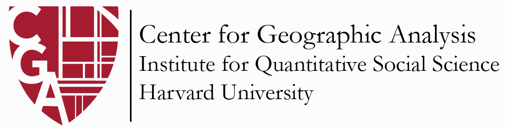

<p align="center"></p>

# Using Python for Geospatial Analysis and Visualization

Workshop materials from the Harvard Center for Geographic Analysis (CGA). Across four Google Colab notebooks, you'll use out-of-hospital cardiac arrest (OHCA) events in Georgia to practice spatial autocorrelation, spatial heterogeneity (GWR), spatial clustering, and spatial accessibility (2SFCA) analysis in Python.

**Web version of these instructions:** [`index.html`](index.html)

## Workshop details

| | |
|---|---|
| **Lead Instructor** | Devika Jain |
| **Time** | 01:00 PM–04:00 PM, November 20, 2026 |
| **Location** | 1737 Cambridge St., Cambridge, MA, CGIS Knafel Building, Room SB-12, Sub-Basement |
| **Zoom** | [https://harvard.zoom.us/j/92058503195](https://harvard.zoom.us/j/92058503195?pwd=lK3lJ1r63GfAlTbcan7ZDVDajKvUJc.1) |

## Repository structure

```text
.
├── data/                 # Input data (OHCA events, county & ZCTA shapefiles, Georgia SVI)
│   └── outputs/          # Example outputs produced by the notebooks (CSV, GeoJSON, PNG)
├── docs/                 # Workshop-Instructions.docx
├── images/               # Screenshots used in these instructions
├── notebooks/            # Google Colab notebooks for the four analyses
├── slides/               # Workshop slide deck
├── index.html            # Web version of the workshop instructions
└── README.md
```


